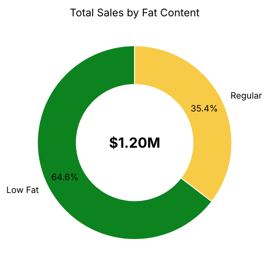
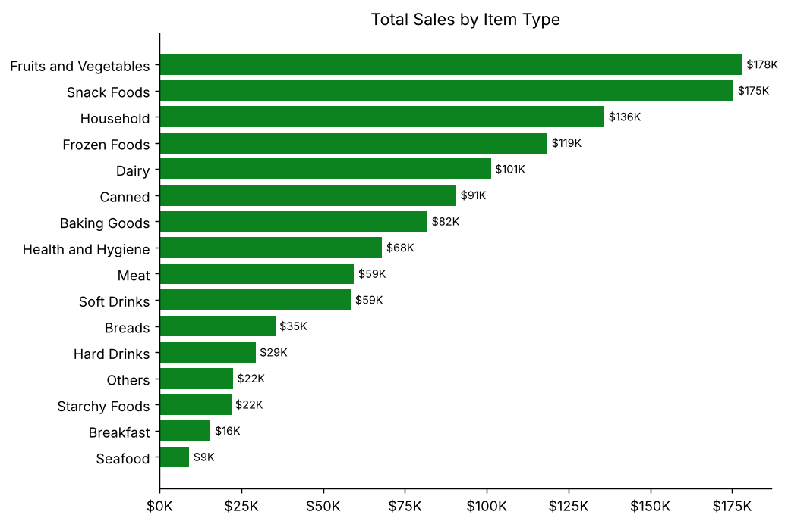
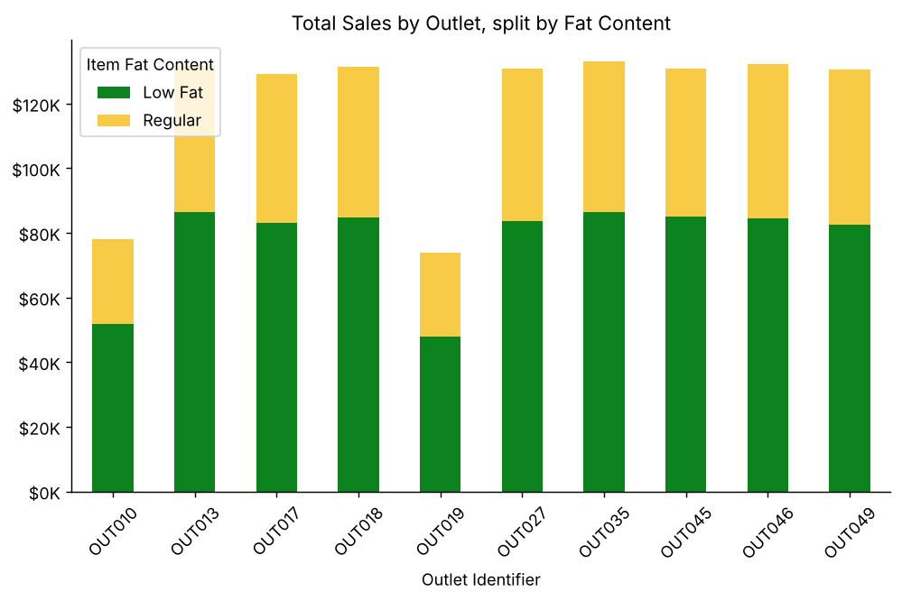
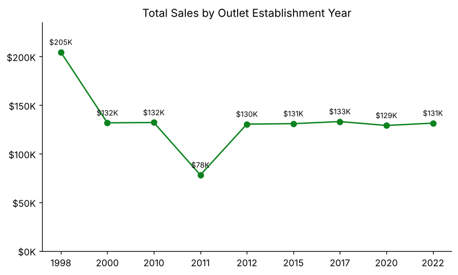
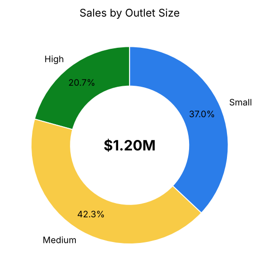
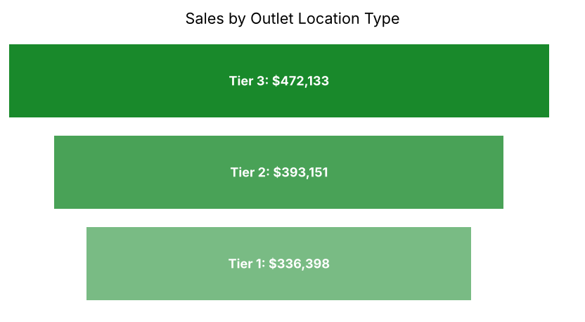

# Blinkit Sales Analysis

An exploratory data analysis of Blinkit (quick-commerce grocery) item and outlet data, built in a Jupyter Notebook with Python. The project calculates key sales and customer-satisfaction KPIs and visualises how sales vary by fat content, item type, outlet, outlet age, outlet size and outlet location.

The analysis follows a business requirement originally specified for Power BI, reproduced here in Python with `pandas`, `matplotlib` and `plotly`.

---

## Table of Contents

1. [Business Requirement](#business-requirement)
2. [Dataset](#dataset)
3. [Project Structure](#project-structure)
4. [KPIs](#kpis)
5. [Analysis and Charts](#analysis-and-charts)
6. [Data Cleaning](#data-cleaning)
7. [Key Findings](#key-findings)
8. [Author](#author)

---

## Business Requirement

Conduct a comprehensive analysis of Blinkit's sales performance, customer satisfaction and inventory distribution to identify key insights and opportunities for optimisation, using KPIs and visualisations.

## Dataset

`blinkit_data.csv` contains **8,523 rows** and **12 columns**. Each row is one item record sold at an outlet.

| Column                        | Description                                                  |
| ----------------------------- | ------------------------------------------------------------ |
| `Item Fat Content`          | Fat category of the item (Low Fat / Regular, after cleaning) |
| `Item Identifier`           | Unique product ID                                            |
| `Item Type`                 | Product category (e.g. Dairy, Snack Foods, Household)        |
| `Outlet Establishment Year` | Year the outlet was established                              |
| `Outlet Identifier`         | Unique outlet ID (10 outlets)                                |
| `Outlet Location Type`      | Location tier (Tier 1, Tier 2, Tier 3)                       |
| `Outlet Size`               | Outlet size (Small, Medium, High)                            |
| `Outlet Type`               | Outlet format (e.g. Supermarket Type1)                       |
| `Item Visibility`           | Share of display area allotted to the item                   |
| `Item Weight`               | Item weight (1,463 missing values; not used in any KPI)      |
| `Sales`                     | Sales amount for the item record                             |
| `Rating`                    | Customer rating of the item                                  |

## Project Structure

```
.
├── Blinkit_Analysis.ipynb   # Full analysis notebook
├── blinkit_data.csv         # Dataset (place in the same folder as the notebook)
├── Blinkit_Analysis.pptx    # Business requirement slides (optional)
├── images/                  # Chart screenshots used in this README
└── README.md
```

## KPIs

| KPI                       | Definition                          | Value      |
| ------------------------- | ----------------------------------- | ---------- |
| **Total Sales**     | Sum of `Sales` across all records | $1,201,681 |
| **Average Sales**   | Mean `Sales` per item record      | $140.99    |
| **Number of Items** | Count of item records               | 8,523      |
| **Average Rating**  | Mean `Rating` across all records  | 3.97       |

Every chart is accompanied by a table showing Total Sales plus the other three KPIs for that grouping, so you can see how Average Sales, Number of Items and Average Rating vary alongside total sales.

## Analysis and Charts

| # | Chart                                    | Type           | Objective                                   |
| - | ---------------------------------------- | -------------- | ------------------------------------------- |
| 1 | Total Sales by Fat Content               | Donut          | Impact of fat content on sales              |
| 2 | Total Sales by Item Type                 | Horizontal bar | Which item types perform best               |
| 3 | Fat Content by Outlet                    | Stacked column | Compare outlets, split by fat content       |
| 4 | Total Sales by Outlet Establishment Year | Line           | How outlet age relates to sales             |
| 5 | Sales by Outlet Size                     | Donut          | Relationship between outlet size and sales  |
| 6 | Sales by Outlet Location                 | Funnel         | Distribution of sales across location tiers |

> **Note on chart 6:** the original requirement asks for a funnel *map*. The dataset only contains location tiers (Tier 1/2/3) and no geographic coordinates, so a funnel chart by tier is used instead.

## Data Cleaning

- **Fat content standardisation:** the raw column has five labels (`Low Fat`, `Regular`, `LF`, `low fat`, `reg`). They are merged into two: `Low Fat` and `Regular`.
- **Missing values:** only `Item Weight` has missing values (1,463). It is not used in any KPI or chart, so it is left as is.

## Key Findings

Overall, ratings are around 4.0 across every segment, so differences in total sales come mainly from the number of items sold rather than from price or customer satisfaction.

### 1. Total Sales by Fat Content



Low Fat items account for about **65%** of sales ($776K vs $425K for Regular). Average sales and average rating are nearly identical for both.

### 2. Total Sales by Item Type



**Fruits and Vegetables** ($178K) and **Snack Foods** ($175K) lead. Seafood, Breakfast and Hard Drinks contribute the least.

### 3. Fat Content by Outlet



Eight outlets sell roughly $129K to $134K each. **OUT010** (about $78K) and **OUT019** (about $74K) are well below the rest.

### 4. Total Sales by Outlet Establishment Year



1998 shows the highest total ($205K), but this year appears to combine two outlets (OUT019 and OUT027 together add up to exactly this figure), so it is not a like-for-like comparison. 2011 is the lowest ($78K, a single outlet: OUT010). All other years sit at around $130K.

### 5. Sales by Outlet Size



Medium outlets lead ($508K), followed by Small ($445K) and High ($249K).

### 6. Sales by Outlet Location



Tier 3 generates the most sales ($472K), then Tier 2 ($393K) and Tier 1 ($336K).

---

## Author

**Maluki Morris**
[GitHub](https://github.com/MalukiMorris) · [X](https://x.com/malukii_)
